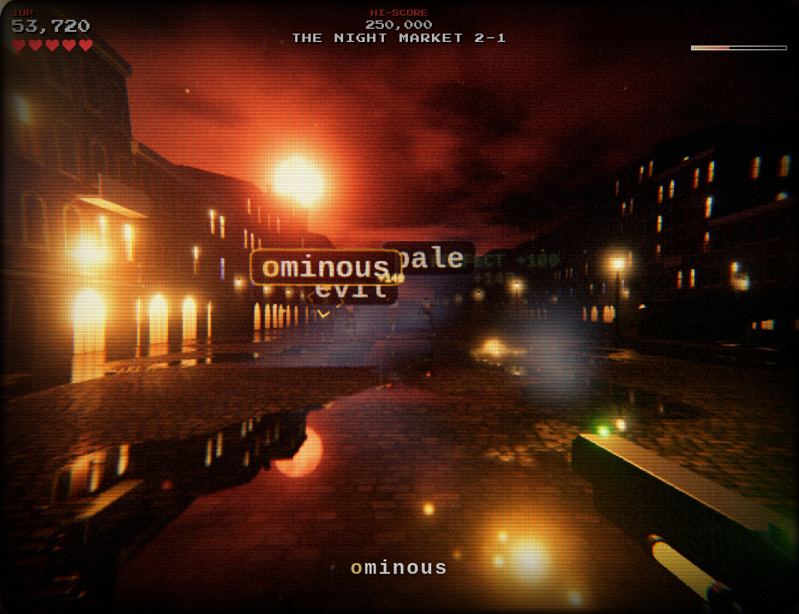

# TYPE OR DIE

A keyboard horror rail-shooter for the browser — an original, legally-distinct
homage to the classic "type words to shoot zombies" arcade genre. Built with
Three.js (WebGL) and Vite. No art or audio assets: every zombie, building, and
sound effect is generated procedurally at runtime.



## Story

The canal city of **Porto Morto** has gone quiet. You are Agent **Verdana** of
the Bureau of Ergonomic Defense, armed with a field keyboard wired to a car
battery on your back. Fight up the canal through **three stages of three
districts each**, and put down a giant at the end of every stage:

1. **The Quayside** → **Big Beppe, "The Gondolier"** (throws rotten fish)
2. **The Night Market** → **Madame Griselda, "The Head Chef"** (throws cleavers)
3. **The Counting House** → **Aurelius Vane, "The Chancellor"** — a banking
   tycoon with strong opinions about compound interest and the apocalypse
   (throws gold coins, then asks you a question).

## How to play

- **Type the word** floating above a ghoul to open fire — every correct letter
  is a shot, finishing the word drops it.
- The first letter you type **locks on** to the nearest matching target; typos
  break your combo (and your accuracy grade). A tag turns red when its ghoul
  is close enough to hurt you.
- Don't let them reach you — you have 5 hearts. A ghoul that lands a hit is
  knocked back and gets a fresh start on its word.
- **Know your enemy:**
  - **Walker** — slow, stupid, persistent. Some climb dripping out of the canal.
  - **Runner** — sprints at you with short words.
  - **Crawler** — lost its legs, drags itself in close and low.
  - **Bloater** — glowing green gut; pop it and the blast takes nearby ghouls
    with it (chain kills score big). Let it reach you and it bursts in your face.
  - **Brute** — a hard-hatted giant with long words that hits for two hearts.
  - **Barista** — amber eyes, still carrying the cup; drop it for a heart.
- **Power-up canisters** drift over the street — type their word to grab them:
  **medkit** (+1 heart), **napalm** (clears the street), **freeze** (the horde
  moves through syrup), **double score**.
- **Boss fights:** type the boss's doom-laden sentences before the amber timer
  runs out, and shoot down everything it throws at you in between.
- **Three endings**, decided by how you answer the Chancellor's final
  question — truthfully, greedily, or strangely.
- `Esc` pauses. `Enter` confirms / continues (continues cost coffee — you have
  nine seconds to decide).

Scoring: 10 points per letter with a combo multiplier (up to x8) every
10-streak, kill bonuses by word length, **PERFECT** bonuses for long words
typed without a slip, and an **extra life** every 30,000 points. Each stage ends
with an arcade bonus tally (accuracy, max combo, no-damage), the run ends with a
rank (D–S) from accuracy, WPM and coffee consumed, and a top score earns your
initials on the high-score table.

### Languages and dictionaries

Pick **English** or **Deutsch** on the title screen, and a dictionary:
**Horror / Grusel**, **Office / Büro**, **Kitchen / Küche**, **Tech / Technik**,
**Classic / Klassik** (everyday words, good for practice) or **Mixed / Alles**.
Each comes in five tiers, from three-letter panic words to whole sentences, and
the stages climb through them. Boss lines, the final question and the endings
are translated too. German words use real umlauts; on a keyboard without them,
set **UMLAUTS** to `AE OE UE` and every ä/ö/ü/ß becomes ae/oe/ue/ss.

### The cabinet

Like a real 90s machine, the game boots with a ROM check, shows the publisher
card, slams the chrome logo in, then cycles through the story, the enemy
roster, the high-score table and a how-to page before it plays a **demo** by
itself. Any key takes the controls back; `Enter` inserts a coin. A synthesized
announcer calls out stages, combos and power-ups (switchable), and the
**CRT filter** adds scanlines, a shadow mask and a curved tube.

## Run it

```sh
npm install
npm run dev      # dev server, prints a local URL
npm run build    # production build in dist/
npm run preview  # serve the production build
```

Requires Node 18+.

## Tech notes

- **Rendering:** Three.js PBR into a half-float HDR target, then bloom,
  ACES tone mapping, FXAA and a film-stock grade pass (lens distortion,
  edge chromatic aberration, teal/amber split tone, grain, vignette,
  red damage pulses and blood running down the lens). Every texture is
  painted into canvases at startup: granite setts with normal maps and a
  puddle map, six styles of canal-house facade (plaster, exposed brick,
  shutters, Venetian arches, lit interiors in an emissive map), dead skin,
  grave clothes, splatter decals.
- **The city:** a planar mirror pass reflects lamps, windows, lightning
  and the horde in the puddles and the canal, with raindrop ripples and
  wave distortion. A procedural sky dome draws fbm storm clouds drifting
  over a cratered moon, and forked lightning bolts throw shadows from
  the shadow-casting moon and strike lights. Terraces of canal houses
  with cornices, balconies and funnel chimneys line both banks, joined
  by humped stone bridges, striped mooring poles and rocking gondolas.
  Cast-iron lamps hang volumetric light cones in the rain, and a pool of
  real point lights follows the nearest ones. Each district crossfades
  its own fog, mist, rain, cloud cover and moon.
- **The horde:** multi-jointed ghouls in five kinds (walker, runner, crawler,
  bloater, brute) with their own gaits — the shamble, a flailing sprint,
  hand-over-hand crawling — and hollow-cheeked skulls: black eye sockets with
  burning pinpoints, a rotted-off nose, patchy scalps, torn-away skull,
  gap-toothed jaws, a spine ridge, ribs and office ties,
  a moonlit rim light and a hit flare on every letter. Killed ghouls burn
  away from a noise front in glowing embers. Instanced blood droplets,
  bouncing gibs, drying splatter decals, spark streaks, red mist and
  muzzle smoke. The Chancellor wears a pinstriped tailcoat and monocle,
  with a halo of gold coins in orbit.
- **The sidearm:** a bevelled pistol with green tritium night sights and
  a glowing amber battery cell, reflecting a small generated environment
  map, plus a lock-on reticle around the current target.
- **Frame rate:** instanced lamps and particles, merged zombie parts, and
  an automatic resolution step-down if frames run long (`?fixedq`
  disables it; `?debug` exposes the renderer for profiling).
- **Gameplay flourishes:** typed dismemberment (each letter strips a part,
  the last pops the head; the boss loses his hat, arms, and jaw one phrase
  at a time), ghouls that climb dripping out of the canal, five per-district
  atmospheres crossfaded along the rail, bullet-time on wave-clear and
  boss-final kills, a healing barista ghoul, and an idle-triggered attract
  mode where the game demos itself.
- **Audio:** all WebAudio synthesis — an adaptive four-layer score (sub
  pulse, bass, creeping arpeggio, hats and dissonance) that follows how
  close the horde is, layered gunshots that pitch up with your combo,
  splats, panned zombie groans, thunder, a low-HP heartbeat, boss roars, a
  generated convolution reverb, and a wind-drone-and-bell ambience.
- **Arcade layer:** the attract loop, high scores (kept in `localStorage`),
  combo announcer, stage tallies and continue countdown are plain DOM over the
  WebGL canvas, styled with the *Press Start 2P* and *Metal Mania* fonts
  (bundled via Fontsource, both SIL OFL). The announcer voice is the browser's
  speech synthesizer pitched down; it stays silent where none is available.
- **No trademarks:** all names, words, phrases, and story are original.
