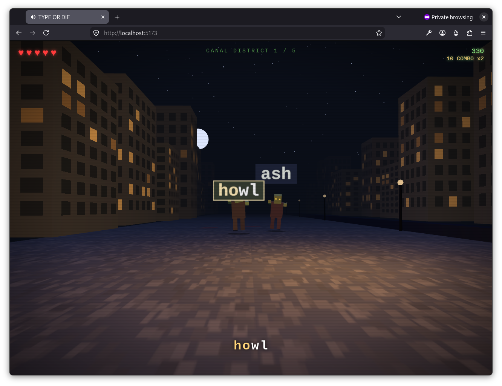

# TYPE OR DIE

A keyboard horror rail-shooter for the browser — an original, legally-distinct
homage to the classic "type words to shoot zombies" arcade genre. Built with
Three.js (WebGL) and Vite. No art or audio assets: every zombie, building, and
sound effect is generated procedurally at runtime.



## Story

The canal city of **Porto Morto** has gone quiet. You are Agent **Verdana** of
the Bureau of Ergonomic Defense, armed with a field keyboard wired to a car
battery on your back. Fight through five canal districts, then face
**Aurelius Vane, "The Chancellor"** — a banking tycoon with strong opinions
about compound interest and the apocalypse.

## How to play

- **Type the word** floating above a ghoul to open fire — every correct letter
  is a shot, finishing the word drops it.
- The first letter you type **locks on** to the nearest matching ghoul; typos
  break your combo (and your accuracy grade).
- Don't let them reach you — you have 5 hearts. A ghoul that lands a hit is
  knocked back and gets a fresh start on its word.
- Every letter you land shoots a piece off — hands, arms, jaw — and the
  final letter takes the head. Watch the canal: some of them wade out of it.
- A rare **barista ghoul** (amber eyes, still carrying the cup) refunds one
  heart when dropped.
- Each district has its own weather — mist, blackout, blood moon, storm —
  and the synth score gets busier the closer the horde shambles.
- Idle on the title screen for a while and the game will play itself
  (arcade attract mode — any key takes back the controls).
- **Boss fight:** type his full doom-laden sentences before the amber timer
  runs out, or take a hit.
- **Three endings**, decided by how you answer his final question — truthfully,
  greedily, or strangely.
- `Esc` pauses. `Enter` confirms / continues (continues cost coffee).

Scoring: 10 points per letter with a combo multiplier every 10-streak, kill
bonuses by word length, and a final rank (D–S) from accuracy, WPM, and coffee
consumed.

## Run it

```sh
npm install
npm run dev      # dev server, prints a local URL
npm run build    # production build in dist/
npm run preview  # serve the production build
```

Requires Node 18+.

### Optional: modelled ghouls

Append `?models` to the URL (e.g. `http://localhost:5173/?models`) to swap the
procedural ghouls for a CC0 skinned glTF zombie with real keyframed animation.
Everything else — the canal, the sidearm, the boss's hat, all of the audio —
stays procedural, and the default build ships neither the mesh nor `GLTFLoader`.
See [ASSETS.md](./ASSETS.md) for provenance and licensing.

Nothing in the typed-dismemberment mechanic was given up for this: because you
cannot detach part of a skinned mesh, `src/zombieModel.js` carves each gib out
of the source mesh at runtime — it takes the triangles weighted to the severed
bone, bakes them at their current animated pose, and collapses the bone. So the
limbs still come off letter by letter without a single authored stump mesh.

## Tech notes

- **Rendering:** Three.js with an HDR bloom post-processing pipeline (ACES
  tone mapping + UnrealBloomPass) — fog-drenched night canal with rain,
  lightning, drifting ground mist and embers; procedural multi-jointed
  ghouls (elbows, knees, swinging jaws, clawed fingers, glowing eyes,
  wounds, fluttering rags) with shamble/lunge/death animations; a
  first-person sidearm in a gloved hand with recoil, muzzle flash and
  ejected shell casings; visible tracer rounds, impact sparks, shockwave
  rings and score popups per keystroke; canvas-texture word labels as
  billboards, vertex-animated canal water, window-lit facades from
  generated textures.
- **Gameplay flourishes:** typed dismemberment (each letter strips a part,
  the last pops the head; the boss loses his hat, arms, and jaw one phrase
  at a time), ghouls that climb dripping out of the canal, five per-district
  atmospheres crossfaded along the rail, bullet-time on wave-clear and
  boss-final kills, a healing barista ghoul, and an idle-triggered attract
  mode where the game demos itself.
- **Audio:** all WebAudio synthesis — an adaptive four-layer score (sub
  pulse, bass, creeping arpeggio, hats and dissonance) that follows how
  close the horde is, layered gunshots that pitch up with your combo,
  splats, panned zombie groans, thunder, a low-HP heartbeat, boss roars, a
  generated convolution reverb, and a wind-drone-and-bell ambience.
- **No trademarks:** all names, words, phrases, and story are original.
